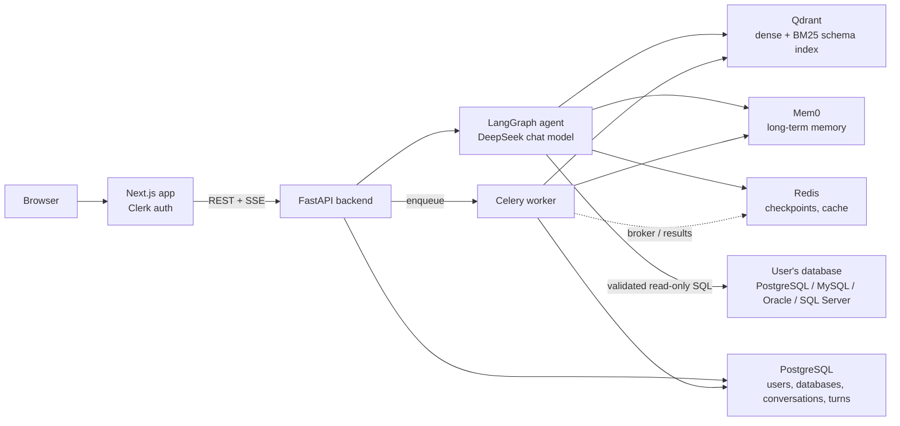

# QueryAI

**Ask your data anything.** QueryAI is an agentic data-analysis assistant. You connect a SQL database, ask questions in plain English, and get back a written analysis, the SQL it ran, and the result rows, all inside a chat interface.

The system is built as a monorepo with a Next.js frontend, a FastAPI backend running a LangGraph agent, a Celery worker for background persistence, and a DeepEval-based harness that measures the agent's behaviour.

---

## Highlights

- **Agentic text-to-SQL, not a single prompt.** A LangChain/LangGraph agent decides when to retrieve schema context, when to run SQL, when to store a memory, and when to ask a clarifying question. Its tool use is bounded by middleware.
- **Hybrid schema retrieval.** Each registered database's schema is embedded into Qdrant as dense vectors plus BM25 sparse vectors, fused with Reciprocal Rank Fusion. Retrieval is tenant-scoped per user and per database.
- **Read-only SQL, validated before execution.** Generated SQL is parsed with `sqlglot` and only single `SELECT`/`WITH` statements pass. Database credentials are encrypted with Fernet at rest, and the frontend ships vendor-specific guides for creating a least-privilege database user.
- **Layered memory.** Short-term conversation state lives in LangGraph checkpoints in Redis. Long-term facts and user preferences live in Mem0, scoped by user, database, and conversation.
- **Streaming chat.** The chat endpoint streams Server-Sent Events: SQL tool calls, tool results, the final answer, and a done marker.
- **Measured agent quality.** An evaluation harness runs the real agent against a benchmark-style dataset and scores it on 15 metrics, including SQL correctness, tool ordering, memory quality, and grounding.
- **Full-stack TypeScript and Python.** Bun workspaces and Turborepo orchestrate the TypeScript side. uv workspaces manage the Python packages. Everything ships as one Docker image through GitHub Actions.

---

## Features

| Area | What it does |
| --- | --- |
| Database registration | Register PostgreSQL, MySQL, Oracle, or Microsoft SQL Server databases. The form accepts a connection URL and fills in the fields, or the fields can be entered directly. |
| Setup guides | Per-engine step-by-step SQL for creating a dedicated read-only account, with copy-ready commands and troubleshooting notes. |
| Schema extraction | On registration, tables, columns, types, nullability, and foreign keys are read through SQLAlchemy inspection. |
| Sample databases | Five built-in sample domains (solar plant operations, polar station equipment, museum artifact conservation, archaeological 3D scanning, and a household survey) can be registered without supplying credentials. |
| Natural-language chat | Ask questions in plain English. The agent retrieves relevant schema, writes SQL, runs it, and explains the result. |
| Live progress trail | The UI shows each step as it happens: finding tables, running a read-only query, writing the analysis. Each SQL query is displayed with its result rows. |
| Conversations | Conversations are titled automatically by an LLM. History is persisted per database and can be reopened, with the most recent turns restored. |
| Remembered context | The agent stores durable database facts and user preferences across sessions and reuses them. |
| Sample explorer | Browse a sample database's tables, columns, relationships, sample rows, knowledge base entries, and suggested questions. |
| Landing page | A product landing page with a simulated demo workspace. Its scenarios are labelled as demonstrations and never touch a real database. |

---

## How a question gets answered

1. The user sends a question to `POST /api/chat/` with a Clerk session token.
2. The backend authenticates the request, then loads the database's connection record and dense schema. The record comes from a Redis cache with a 2-hour TTL, or from Postgres on a cache miss.
3. For a new conversation, a small LLM call generates a 3–8 word title and creates the conversation row. For an existing conversation, the agent state is restored from the Redis checkpoint. If that checkpoint has expired, the last five turns are rebuilt from Postgres.
4. Long-term user preferences are fetched from Mem0 and cached in Redis for the conversation.
5. The agent streams its run. Each `run_sql` call is emitted as a `tool_call` event, and its output as a `tool_result` event. The final answer is emitted as an `output` event.
6. When the answer is complete, the turn (question, answer, and SQL) is handed to a Celery task that writes it to Postgres. The response then ends with a `done` event.

Between the first and last steps, the agent can call `retrieve_context`, `search_db_facts`, `run_sql`, and `add_memory`, within the per-turn limits described below.

---

## Architecture



### Services

| Service | Role |
| --- | --- |
| **Next.js web app** (`apps/web`) | Landing page, dashboard, database registration, sample explorer, and the streaming chat workspace. Clerk handles sign-in, and the dashboard routes are protected. |
| **FastAPI backend** (`apps/backend`) | REST and SSE API. Clerk authentication middleware on every route. Hosts the agent. |
| **Celery worker** (`apps/task_queue`) | Persists turns, writes memories, and indexes schemas, so user-facing requests never wait on those writes. |
| **PostgreSQL** | Application metadata: users, registered databases (with encrypted credentials), conversations, and turns. Schema managed with Alembic. |
| **Redis** | Celery broker and result backend, LangGraph checkpoint store, and cache for database configs and user preferences. |
| **Qdrant** | Vector index of each registered database's schema, one tenant per user and database. |
| **Mem0** | Long-term memory: database facts and user preferences. |
| **User's database** | The analytical database being queried. Accessed only through validated read-only SQL. |

---

## The agent

The agent is built with LangChain's `create_agent` on top of LangGraph. It uses a DeepSeek chat model through `langchain-deepseek`.

### Tools

| Tool | Purpose |
| --- | --- |
| `retrieve_context` | Hybrid search (dense + BM25, RRF-fused) over the registered database's schema. Returns the top 10 matching table descriptions. |
| `search_db_facts` | Searches stored database facts from earlier conversations, such as join paths, column meanings, and naming conventions. Call this before schema retrieval. |
| `run_sql` | Validates the query, decrypts the database credentials, runs it against the user's database, and returns the rows as JSON. |
| `add_memory` | Stores a durable fact or preference (confidence 0.5–1.0) for future sessions. Dispatched to Celery. |

### Guardrails

- **Tool budgets.** `retrieve_context` is limited to 2 calls per turn and `run_sql` to 4, enforced by LangChain's `ToolCallLimitMiddleware`. Parallel tool calls are disabled, so the agent works through tools one at a time.
- **Per-run context.** Each run carries a `Context` object with the tenant ID, database engine, schema, encrypted credentials, and user preferences. Tools read their state from this object.
- **Dynamic prompting.** Two LangGraph middleware functions (`dynamic_prompt` and `wrap_model_call`) rebuild the system prompt at every model call instead of using a fixed string. One appends the database engine, the dense schema, and the remembered user preferences to the base instructions. The other sets `parallel_tool_calls` to false on the request. Along with the tool-budget middleware, this is what lets a single compiled agent serve any database and any user without a per-tenant prompt.

### Read-only SQL validation

`run_sql` parses every query with `sqlglot` in the target dialect and enforces the following:

- Exactly one statement.
- The statement must be a `SELECT`, `WITH`, `UNION`, or subquery.
- `SELECT ... INTO` is rejected.
- The AST is searched for write, DDL, grant, copy, and command nodes, and any match is rejected.

This validation is a guardrail rather than the security boundary. The real boundary is a least-privilege database account, which the setup guides walk users through creating.

### Schema representation

Schema is stored in two forms:

- **Dense schema**, a compact text summary kept on the database row and placed into every system prompt. Each table gets a line listing its columns and join relationships, so the agent knows the shape of the database before it retrieves anything.
- **Full schema documents**, one per table with column names, types, nullability, and relationships. These are embedded and indexed in Qdrant for retrieval.

---

## Memory

| Layer | Storage | Contents | Lifetime |
| --- | --- | --- | --- |
| Short-term | LangGraph `AsyncRedisSaver` checkpoints | Message state for the current conversation | Redis TTL set in the checkpointer config, refreshed on read. Falls back to the last 5 turns in Postgres. |
| Long-term: facts | Mem0 | `db_fact` memories, shared across conversations for the same database | Persistent |
| Long-term: preferences | Mem0 | `user_preference` memories, loaded per conversation | Persistent |

Memories are written by a Celery task (`memory_write`) with `infer=False`, so the stored text is exactly what the agent produced and nothing is re-interpreted by the memory service.

---

## Data model

Defined with SQLModel in `packages/db`. Migrations are managed with Alembic.

| Table | Key fields | Relationships |
| --- | --- | --- |
| `users` | `clerk_id` (unique), `username`, `email` | 1:N `user_databases` |
| `user_databases` | `encrypted_creds`, `database_name`, `database_soft` (engine), `description`, `dense_schema`, `sample_db` | belongs to user, 1:N `conversations` |
| `conversations` | `title`, `database_id` | belongs to database, 1:N `turns` |
| `turns` | `user_query`, `ai_response`, `sql_query` (array), `created_at` | belongs to conversation |

Deleting a database cascades to its conversations and turns. Its vectors are removed from Qdrant by tenant filter.

---

## API

All routes are under `/api` and require a Clerk bearer token, except the webhook and the docs routes.

| Method | Path | Description |
| --- | --- | --- |
| `POST` | `/api/auth/webhook` | Clerk user lifecycle webhook (created, updated, deleted). Signature verified with Svix. |
| `GET` | `/api/database/` | List the current user's registered databases. |
| `POST` | `/api/database/` | Register a database from custom credentials or a sample ID. Extracts the schema and queues indexing. Returns `201`. Duplicate names return `409`. |
| `DELETE` | `/api/database/{db_id}/` | Delete a database, its conversations, and its vectors. |
| `GET` | `/api/conversation/{db_id}/` | Database details, its conversations, and suggested questions for sample databases. |
| `POST` | `/api/chat/` | Send a question. Streams SSE events: `tool_call`, `tool_result`, `output`, `done`, and an error event on failure. |
| `GET` | `/api/turns/{db_id}/{conversation_id}/` | The five most recent turns in a conversation, newest first. |

### Chat stream events

```text
data: {"type": "tool_call",   "data": {"query": "SELECT ..."}, "conversation_id": "..."}
data: {"type": "tool_result", "data": "[{...}, ...]",          "conversation_id": "..."}
data: {"type": "output",      "data": "Final answer ...",      "conversation_id": "..."}
data: {"type": "done",                                         "conversation_id": "..."}
```

The final answer currently arrives as one `output` event. The frontend reveals it word by word.

---

## Security

- **Authentication.** Clerk session tokens are verified by the backend middleware on every request. The middleware restricts authorised parties to the configured frontend origin.
- **Tenant isolation.** Each data path is keyed by the Clerk user ID. Database lookups filter by owner. Qdrant points carry a `user_id__db_id` tenant payload and are filtered on every search. Mem0 memories are filtered by user and database.
- **Credentials at rest.** Database passwords are encrypted with Fernet before they are stored. They are decrypted in memory only for the duration of a query, and the Redis cache stores only the encrypted form.
- **Read-only execution.** AST validation plus the recommended least-privilege database role. The setup guides give explicit grants for each engine rather than broad privileges.
- **Webhook verification.** Clerk webhook payloads are verified against the Svix signature before they are processed.
- **Bounded agent runs.** Tool budgets cap how much work the agent can do in one turn, and each SQL result is fetched with a row limit.

---

## Frontend

Built with Next.js 16 (App Router), React 19, Tailwind CSS v4, and shadcn-style components on Radix/Base UI primitives. The UI is dark-first and uses Geist Sans and Geist Mono. Data fetching uses Axios for REST and `fetch` with a custom SSE parser for the chat stream. Response payloads are validated with Zod.

| Route | Purpose |
| --- | --- |
| `/` | Landing page: hero, how it works, agent pipeline, features, trust section, call to action, and a simulated demo workspace. |
| `/dashboard` | Database overview with the registration dialog. The dialog has a vendor picker, connection URL parsing, and a per-engine read-only setup guide. |
| `/database/[databaseId]` | Chat workspace: conversation sidebar, streaming transcript, SQL cards with result tables, Markdown answers, and suggested questions for sample databases. |
| `/dashboard/samples/[sampleId]` | Sample database explorer with tables, columns, relationships, and sample rows. |

Clerk handles sign-in and sign-up through modals. `proxy.ts` protects `/dashboard` routes.

---

## Background processing

The Celery worker runs with the `solo` pool and uses Redis as broker (database 0) and result backend (database 1). Each task retries up to 3 times with a 120-second delay.

| Task | Trigger | Work |
| --- | --- | --- |
| `insert_chats_in_db` | End of every chat turn | Writes the turn (question, answer, SQL) to Postgres. |
| `memory_write` | `add_memory` tool call | Writes a memory to Mem0 with its category and confidence. |
| `ingest_schema` | Database registration | Embeds each table's schema document and upserts it into Qdrant with the tenant payload. |

---

## Evaluation harness

`packages/evals` runs the real agent against a benchmark-style JSONL dataset (BIRD-Interact format) and scores the results with DeepEval. The judge model is reached through an OpenAI-compatible endpoint.

- **Answer quality:** answer relevancy, insight completeness, and faithfulness, plus contextual relevancy when retrieval evidence exists.
- **SQL:** SQL correctness against a reference query, and SQL error recovery.
- **Tool use:** tool ordering, call efficiency, and tool correctness when a case specifies expected tools.
- **Memory:** memory-write quality and memory utilisation.
- **Behaviour:** clarifying-question quality, DB fact relevancy, and reasoning coherence and groundedness. These judge observable actions and grounding in tool output, not hidden reasoning.

The harness wraps the agent's SQL and retrieval tools with stricter checks and intercepts the Celery dispatch for memory writes, so an evaluation run does not change long-term memory state. Reports are written as timestamped JSON under `packages/evals/results/`.

Thresholds are set between 0.5 and 0.7 per metric. Runs need live services (the LLM provider, Redis, Qdrant, Mem0, and a test tenant), so the evaluation is not part of the normal test path.

---

## Tech stack

| Layer | Technologies |
| --- | --- |
| Frontend | Next.js 16, React 19, TypeScript, Tailwind CSS v4, shadcn-style UI on Radix / Base UI, Clerk, Axios, Zod, react-markdown, remark-gfm, Lucide icons |
| Backend API | Python 3.14, FastAPI, Pydantic, Uvicorn, Clerk backend SDK, Svix |
| Agent | LangChain 1.x (`create_agent`), LangGraph, `langchain-deepseek`, LangSmith tracing support |
| Retrieval | Qdrant (dense 1024-d cosine + BM25 sparse with IDF, RRF fusion, tenant payload index), Qdrant Cloud Inference with an OpenRouter-hosted embedding model |
| Memory | Mem0 (long-term), LangGraph Redis checkpointer (short-term) |
| SQL safety | sqlglot AST validation |
| Data access | SQLModel, SQLAlchemy inspection, Alembic, psycopg, psycopg2, PyMySQL, python-oracledb, pyodbc |
| Security | Fernet (`cryptography`) for credentials, Clerk for auth, Svix for webhook signatures |
| Async work | Celery, Redis |
| Evaluation | DeepEval |
| Tooling | Bun, Turborepo, uv, ESLint, Prettier, TypeScript |
| Delivery | Docker, Docker Hub, GitHub Actions, Docker Compose |

---

## Monorepo layout

```text
QUERYAI/
├── apps/
│   ├── web/                 Next.js frontend (landing, dashboard, chat workspace)
│   ├── backend/             FastAPI API, LangGraph agent, tools, memory, lib helpers
│   └── task_queue/          Celery app and background tasks
├── packages/
│   ├── db/                  SQLModel models, DB engine and session, Alembic migrations
│   ├── config/              Client factories for Qdrant, Redis, and Mem0
│   ├── evals/               DeepEval harness, metrics, dataset loader, results
│   ├── ui/                  Shared React components (@repo/ui): button, card, code
│   ├── eslint-config/       Shared ESLint configuration
│   └── typescript-config/   Shared TypeScript configuration
├── .github/workflows/       CI/CD: build and push the image, then deploy
├── DockerFile               Single image for the whole monorepo
├── docker-compose.yml       Runs the published image
├── turbo.json               Task pipeline (build, dev, start, lint, check-types)
├── package.json             Bun workspaces and root scripts
├── pyproject.toml           uv workspace root
└── bun.lock, uv.lock        Locked dependencies
```

### Backend layout

```text
apps/backend/
├── main.py                  App factory, lifespan (checkpointer and agent), CORS, Clerk middleware
├── app_state.py             Shared agent and checkpointer state
├── schemas.py               Pydantic request models
├── api/
│   ├── router.py            Mounts all endpoint routers under /api
│   └── endpoints/           auth.py, database.py, conversation.py, chat.py, turns.py
├── agent/
│   ├── init.py              Agent construction, system prompt, middleware wiring
│   ├── context.py           Per-run context dataclass
│   ├── middleware.py        Dynamic prompt injection, parallel-tool disabling
│   ├── memory/short.py      Redis checkpointer setup
│   └── tools/               retriever.py, run_sql.py, add_memory.py, search_db_facts.py
└── lib/helpers.py           Fernet encryption, DB connection URLs, schema extraction
```

---

## Build and delivery

The root `DockerFile` builds the whole monorepo into a single image. It installs Bun and uv, runs `bun install` and `uv sync --frozen`, builds every package with `turbo run build`, and starts the services with `turbo run start`. The web app is exposed on port 3000 and the API on port 8000.

The GitHub Actions workflow runs on pushes to `main`:

1. **Build:** builds the image on an ARM64 runner, pushes it to Docker Hub with `latest` and commit-SHA tags, and caches layers in GitHub Actions.
2. **Deploy:** connects to a VM over SSH, resets the checkout to `origin/main`, pulls the new image, and restarts the stack with Docker Compose.

---

## Known limitations

- **Streaming granularity.** The final answer is emitted as one event after the agent finishes. The frontend reveals it word by word, but the backend does not stream tokens.
- **Database editing.** Renaming a database or changing its description is handled client-side only, because the backend does not yet expose an update endpoint.
- **Demo content.** The landing page's workspace demo and its scenarios are simulated and labelled as such.
- **Automated tests.** There is no unit or integration test suite for the application code yet. The only pytest file is the live-agent evaluation in `packages/evals/test_eval.py`, which needs real services and a test tenant.
- **Concurrency.** The Celery worker runs with the `solo` pool, so it processes one task at a time per worker process.
